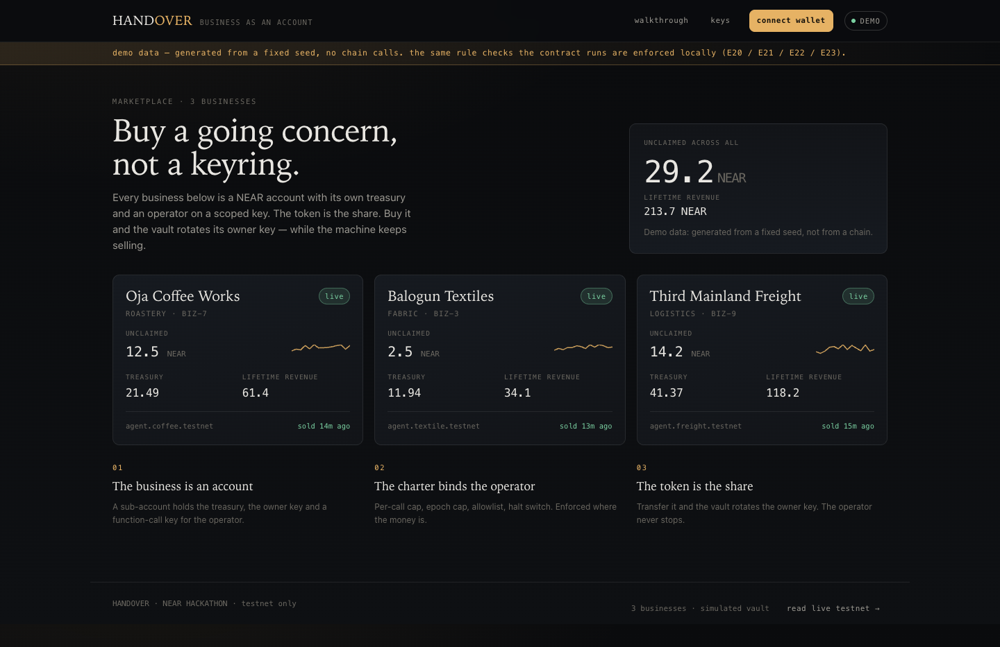
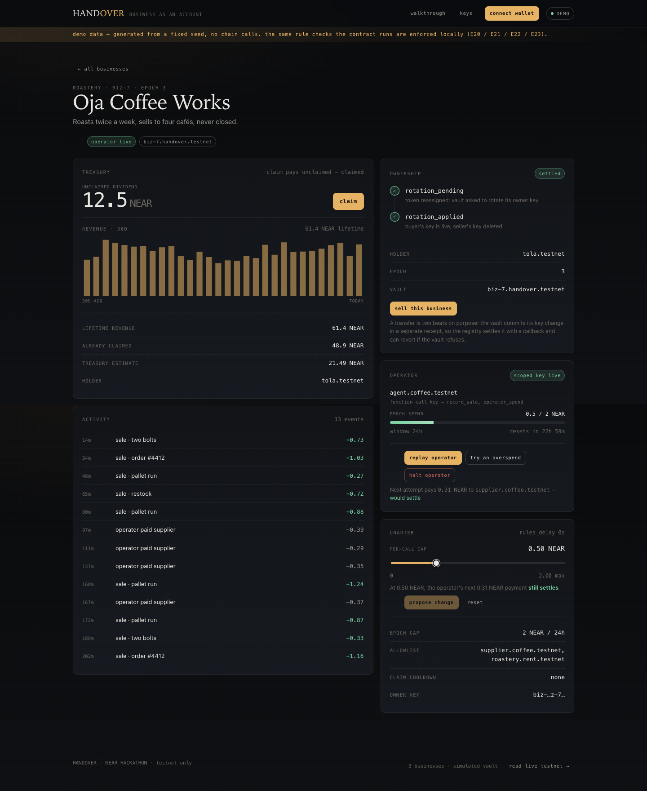
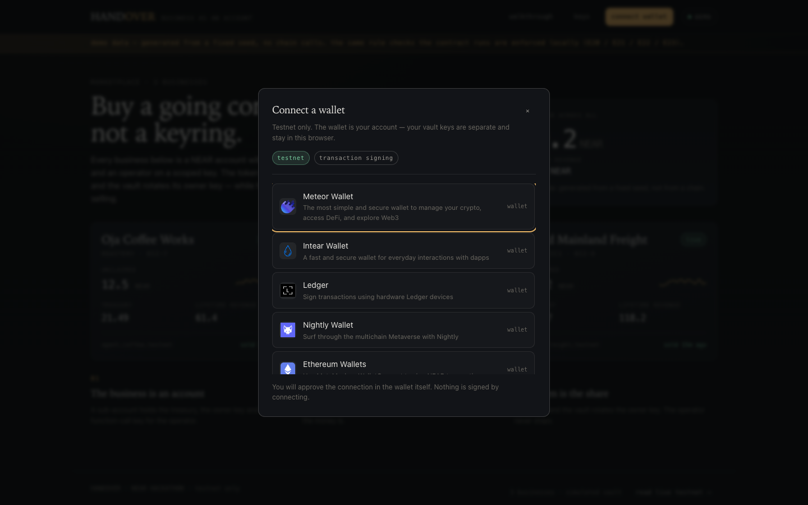
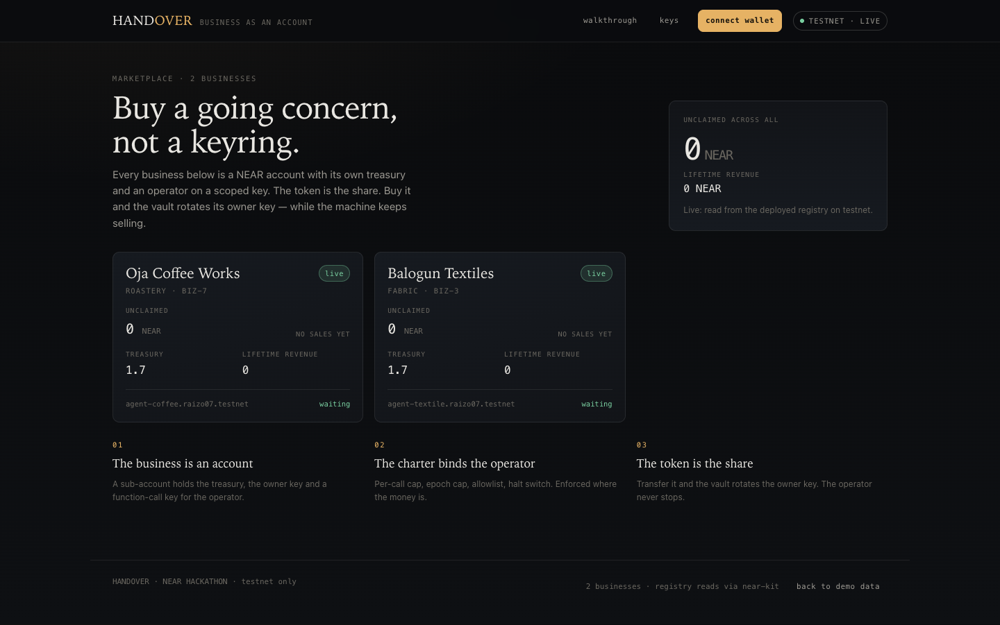

# HANDOVER

**A business is a NEAR account. An NFT is the share.**

*One word to know: a business's **charter** is its rulebook — the caps, the allowlist and the
halt switch the operator runs under. It is a thing inside HANDOVER, not another name for it.*

> **Status — read this first.** Both contracts are written and tested (32 Rust tests,
> including 4 that deploy real wasm into a real NEAR VM), and they are **deployed on
> testnet**:
>
> | | |
> |---|---|
> | Registry | [`reg.raizo07.testnet`](https://testnet.nearblocks.io/address/reg.raizo07.testnet) |
> | Businesses | [`biz-7.reg.raizo07.testnet`](https://testnet.nearblocks.io/address/biz-7.reg.raizo07.testnet) · [`biz-3.reg.raizo07.testnet`](https://testnet.nearblocks.io/address/biz-3.reg.raizo07.testnet) |
> | Deployer | `raizo07.testnet` |
>
> The frontend runs against seeded demo data by default and reads this registry when
> `VITE_REGISTRY_CONTRACT` is set. No mainnet contract exists — the "real vs simulated"
> section below is exact.
>
> **Demo:** <https://raizo07.github.io/handover/> · **film:** [`film/out/handover.mp4`](film/out/handover.mp4)
> (85 s, rebuild with `make film`) · **submission packet:** [docs/SUBMISSION.md](docs/SUBMISSION.md)



## The problem

When a small business is sold, the buyer does not receive a JPEG. They receive an operating
entity: a bank account, a supplier relationship, a booking calendar, and a person or bot who
actually does the work.

On-chain that is impossible today. An NFT can hold a picture and at best a treasury address,
but it cannot *be* the business. Selling means re-keying a multisig, re-papering the entity,
and hoping the operator keeps working while it happens.

HANDOVER makes the ownership instrument and the operating account the same object.

## What it is

One token = one real sub-account (`biz-7.<registry>.testnet`) holding:

- **a treasury** — money the business earns from sales
- **an owner key** — full access, rotated on every transfer of the NFT
- **an operator key** — function-call scoped, held by an autonomous agent, constrained by the
  charter: per-call cap, per-epoch cap, recipient allowlist, halt switch
- **a dividend claim** — `revenue − claimed`, paid to whoever holds the token

Transfer the token and the vault rotates its owner key. The seller is locked out **at the
protocol level** — their key is deleted, so their next transaction fails inside nearcore
before any contract code runs. The buyer inherits the unclaimed dividend. The operator never
stops trading.



## Why NEAR

Named sub-accounts plus fine-grained access keys are why "the asset *is* an account" is true
rather than simulated. On a chain with one key model and no sub-accounts, this is a proxy
contract per token plus a trusted operator; here it is an account, and the separation between
owner and operator is enforced by the protocol rather than by `if` statements in my code.

## The film

[`film/out/handover.mp4`](film/out/handover.mp4) — 85 seconds, 1920×1080, 30 fps, with sound.
Nine scenes on a 96 BPM grid, and two of them are **recorded product**: the hand-over and the
E20 refusal are the real UI, captured with `page.screencast()` and replayed frame by frame
under a keyframed camera. Every sound is synthesised from the same timeline the picture reads,
so a hit you see is a hit you hear.

`make film` rebuilds it (needs ffmpeg, python3 + numpy, and Chrome); `film/README.md` documents
the scenes and the engine.

## Try it

Requires Node 20+ and Rust stable. The demo path needs no wallet, no faucet and no funds.

0. **Follow the walkthrough** — <https://raizo07.github.io/handover/judge>
   The same steps as below, in the app, with the mode you are in explained on the side.

1. **Run the contract tests**
   `make test`
   → `32 passed` across two crates: 13 registry tests, 15 vault unit tests, 4 sandbox
   tests that deploy the wasm and call it in a real VM.

2. **Run the app**
   `make demo` (or `cd web && npm ci && npm run dev` for the dev server)
   → opens `http://localhost:4173`: three businesses, a `DEMO DATA` banner. A connect-wallet button
   is present but nothing requires it.

3. **See the live testnet registry instead of demo data**
   `VITE_REGISTRY_CONTRACT=reg.raizo07.testnet npm run build` (in `web/`), or add `?live=1`
   on the hosted build
   → the badge changes to `TESTNET · LIVE` and the businesses come from chain, not fixtures.
   Live mode disables the vault buttons and says why: those calls are signed by the business
   key, not by a wallet.

4. **Connect a wallet**
   **connect wallet** in the top bar → the picker lists what NEAR Connect offers (Meteor,
   Intear, Ledger, …). After connecting, the chip shows your account with copy, explorer and
   disconnect. It signs registry actions — buying, selling, repairing a rotation — and the
   buy flow uses your address as the buyer.

5. **Watch the charter block the agent**
   On `/b/biz-7`, drag the *per-call cap* slider to about `0.20`. The line under it already
   tells you the verdict the current plan would get. The cap only becomes law when you press
   **propose change** and then **apply** — the charter is timelocked, not a form field.
   Then press **try an overspend** (1.5× the cap) → rejected with `E20`, a receipt drawer
   opens with the reverted call, and the activity feed records a struck-through row.

6. **The same account, allowed**
   With that cap applied, press **replay operator** → it settles, because the replay is
   0.625× the cap by construction. One number decides both outcomes: the overspend is
   refused, the ordinary spend goes through.

7. **Halt the agent**
   Press **halt operator** → the receipt shows `DeleteKey(...)`. Press **replay operator**
   again → `E23`, because the key no longer exists. Press **resume** to re-arm it.

8. **Buy a business**
   Press **sell this business** on any business → generate an owner key (a real ed25519
   keypair in your browser), **download it** (the flow blocks until you do), sign →
   the rotation settles in two beats: `rotation_pending`, then `rotation_applied`, and the
   page states what the seller now sees: `Access key does not exist`. In live mode this
   transaction is signed by your wallet.

9. **Inspect any receipt**
   Every action opens a drawer with the `EVENT_JSON` the contract emits and the action list.
   Wallet-signed calls also link straight to the transaction on the explorer.

10. **Reset**
   **reset demo data** on the walkthrough restores the seeded businesses. Downloaded owner
   keys are kept, because they are separate from the simulation.

## Wallet

The app connects to NEAR testnet through [NEAR Connect](https://github.com/hot-dao/near-connect):
a wallet picker, a connected-account menu (copy address, explorer, disconnect, network,
account count), session restore, and honest error states (cancelled in wallet, wallet
service unreachable, no wallets offered).



**What the wallet can do:** buy and sell a business (`nft_transfer` on the registry, with
the buyer's new owner key in the memo), repair a stuck rotation (`resolve_rotation`), and
act as the identity shown across the app.

**What it cannot do — by design:** claim dividends, halt the operator, or edit a charter.
Those are signed by the *business key*, the bearer key the buy flow generates and makes you
download, because a vault is an account with its own keys rather than a row in the
registry. The UI says exactly that instead of pretending the wallet is enough.

## Deploy (run against testnet)

The deploy script is idempotent and has three modes:

```
make deploy-dry      # print the plan: accounts, wasm hashes, NEAR needed
make deploy-sandbox  # full rehearsal against a local NEAR node
make deploy          # real testnet run, reading .env
```

It has now been run for real on testnet: registry `reg.raizo07.testnet` (214 KB wasm), vault
wasm stored in registry state (162 KB), and **two** businesses minted. Measured cost per
business: **≈1.66 NEAR** of storage for the vault contract (166 KB) plus the account itself;
the third business is unseeded only because the deployer account had 10 NEAR and each mint
takes 2. Fund it with ~3 more NEAR and `make deploy` mints the third (the script is
idempotent and skips what already exists).

The same app pointed at that registry with `VITE_REGISTRY_CONTRACT` renders live chain data:



A testnet run needs a funded named account — **≈12 NEAR** covers the registry, the stored vault
code and three mints (2 NEAR each) — and writes `docs/DEPLOYED.md` with the real addresses. It will not run against
mainnet, and it refuses an implicit 64-character account up front — sub-accounts require a
named parent.

## Real vs simulated (exact)

| Thing | State |
|---|---|
| `registry` + `vault` contracts | **Real.** Built with `cargo near build`, 32 tests green. |
| Key rotation, caps, halt, dividends | **Real** in Rust; **re-enforced** in the demo client so the UI cannot show a state the contract forbids. |
| Browser app | **Real** React/Vite build, served from `dist/`. |
| Chain reads in the browser | **Verified.** Set `VITE_REGISTRY_CONTRACT` (and `VITE_RPC_URL` for a local node) and the app reads the registry through `near-kit`. Checked against the live testnet registry: two businesses, real operator accounts, no demo banner. |
| Chain writes in the browser | **Partly wired.** A connected wallet signs registry actions (`nft_transfer`, `resolve_rotation`). Vault actions are signed by the business key, so the UI refuses them with an explanation instead of faking a signature. |
| Deployed contracts | **Real, on testnet.** Registry `reg.raizo07.testnet` with two businesses minted. Addresses in [docs/DEPLOYED.md](docs/DEPLOYED.md). |

The demo client enforces `E20` (per-call cap), `E21` (epoch cap), `E22` (allowlist), `E23`
(halted), `E27` (claim cooldown), `E28` (nothing to claim), `E29` (rules timelock) and `E32`
(invalid rules) with the same checks as the Rust. It is a simulation of a mechanism, not an
animation of one.

## Layout

```
contracts/registry/   NEP-171 tokens + the two-beat transfer state machine
contracts/vault/      per-business account: treasury, keys, charter, accounting
web/                  React + Vite app; demo client mirrors the contract rules
web/scripts/          headless checks: screenshots, buy flow, wallet, film recording
scripts/              prepare-submission.mjs (validates the payload, never sends)
film/                 the 85-second demo film: plan, engine, score, clips
docs/SPEC.md          state shapes, methods, events, errors, protocol, test matrix
docs/DECISIONS.md     choices and the trigger that would reverse each one
docs/SUBMISSION.md    submission checklist, drafts, and open fields
docs/DEPLOYED.md      the addresses that are actually live
```

## Contract invariants (asserted in tests)

| | Invariant |
|---|---|
| I1 | `vault.holder == token.holder` whenever a rotation is `Applied` |
| I2 | exactly one full-access key on a vault at rest |
| I3 | `claimed_total <= revenue_total`, always |
| I4 | `spent_epoch <= max_spend_per_epoch` after every accepted spend |
| I5 | a failed rotation restores the seller as holder |
| I6 | only `set_holder` mutates vault keys |

## Prior work / baseline

New repository. If any code predates the hackathon window it will be tagged `pre-hackathon`
and the diff linked here (Q-003). Dependencies are stock: `near-sdk`, React, Vite; the hand
written code is this repository's own.

## License

MIT — see [LICENSE](LICENSE).
