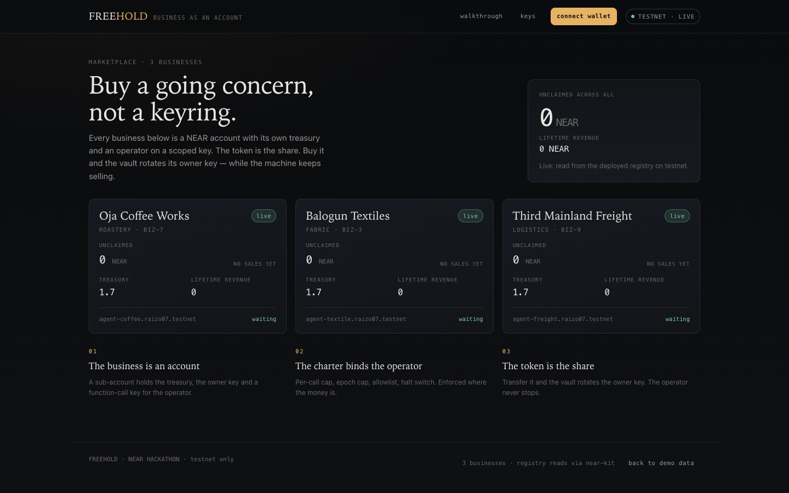

# FREEHOLD

**A business is a NEAR account. An NFT is the share.**

> **Live:** <https://freehold-demo.vercel.app/> · **Mirror:** <https://raizo07.github.io/freehold/>
> **Registry:** [`freehold.raizo07.testnet`](https://testnet.nearblocks.io/address/freehold.raizo07.testnet)
> **Film:** [`film/out/freehold-demo.mp4`](film/out/freehold-demo.mp4) (2:12, sound on)



Three businesses are live on NEAR testnet, each a real sub-account:
`biz-7.freehold.raizo07.testnet`, `biz-3.freehold.raizo07.testnet` and
`biz-9.freehold.raizo07.testnet`. Both contracts are tested — 32 Rust tests, 4 of which deploy
real wasm into a NEAR VM.

## What it is

One token owns one sub-account holding:

- a **treasury** — money the business earns
- an **owner key** — full access, rotated on every sale
- an **operator key** — function-call scoped, held by an agent
- a **charter** — the operator's rulebook: per-call cap, per-epoch cap, allowlist, halt switch

Sell the token and the vault rotates its owner key in two confirmed beats. The seller's key is
deleted, so their next transaction fails inside nearcore. The operator keeps trading. The buyer
inherits the unclaimed dividend.

The charter is what makes the operator safe to leave running: the agent can spend inside its
caps and nothing else. `halt` deletes its key; `resume` re-arms it.

## Why NEAR

Sub-accounts and scoped access keys are why "the asset *is* an account" is true here rather than
simulated. The split between owner and operator is enforced by the protocol — a function-call
key that cannot withdraw, add keys or touch the NFT — not by `if` statements in my code.

## Try it

No wallet, no funds.

1. `make test` → `32 passed`: 13 registry, 15 vault, 4 sandbox.
2. `make demo` → `http://localhost:4173`, three businesses on seeded data.
3. Add `?live=1` → the badge says `TESTNET · LIVE` and the businesses come from chain.
4. On `/b/biz-7`: drag the cap to `0.20`, **propose change**, **apply**, then **try an
   overspend** → refused with `E20` and a receipt.
5. **halt operator** → the key is deleted; the next spend is `E23`. **sell this business** → a
   real ed25519 key in the browser, two beats, `You own it.`
6. `/judge` walks the same steps, with the mode you are in explained beside each one.

Every action opens a receipt showing the `EVENT_JSON` the contract emits.

## Real vs simulated

| | |
|---|---|
| Contracts | **Real.** Deployed on testnet, address above. |
| Chain reads | **Real.** `?live=1` reads the registry through `near-kit`. |
| Wallet | **Real.** NEAR Connect signs `nft_transfer` and `resolve_rotation`. |
| Demo data | **Simulated.** Three seeded businesses, no chain calls. The banner says so. |
| Vault actions | **Simulated** in the browser: those calls need the business key. |

## The film

`film/out/freehold-demo.mp4` — 2:12, 1920×1080, 60 fps. Seven scenes: the problem, the product,
the charter refusing an overspend, the two-beat sale, the on-chain receipt, a second business,
and where to find it. `film/README.md` documents the pipeline; `make film` rebuilds it.

## Deploy

`make deploy-dry` · `make sandbox` · `make deploy`. A run needs ~12 NEAR (registry, stored vault
code, mints at 2 NEAR each) and writes `docs/DEPLOYED.md`.

## Layout

```
contracts/registry/   NEP-171 registry: mints businesses, runs the rotation state machine
contracts/vault/      the business account: treasury, keys, charter, dividends
web/                  React app (demo data by default, chain reads with ?live=1)
film/                 the demo film: timeline, engine, score, render
docs/SPEC.md          state shapes, methods, events, errors, test matrix
docs/DEPLOYED.md      the addresses that are live
```

## License

MIT — see [LICENSE](LICENSE).
