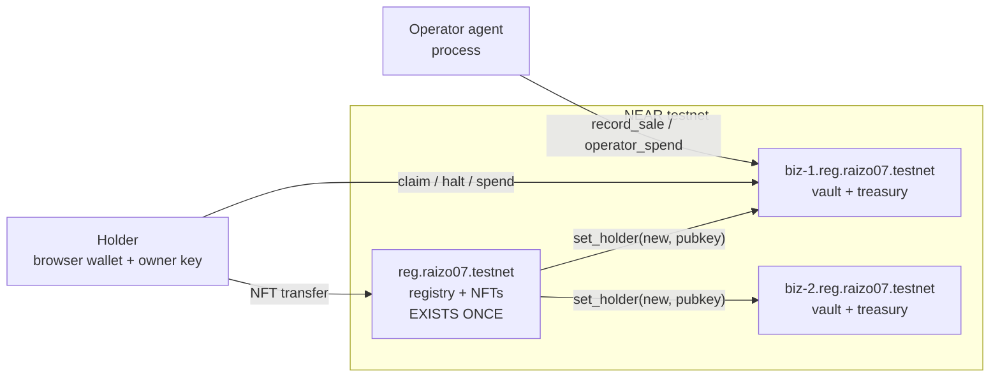
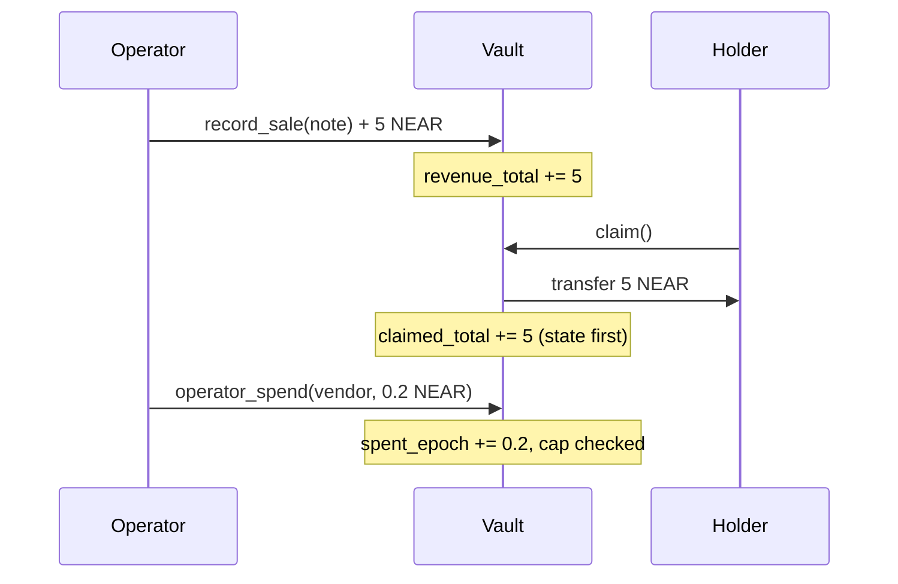

# FREEHOLD — Technical Specification

**Status:** draft v0.3 — both contracts implemented and tested; not deployed.
**Track:** `nfts` (primary), `business` (secondary).
**Repo:** this directory. License MIT.

A one-page version of the pitch lives in [../README.md](../README.md). This file is the
build contract: state shapes, method signatures, events, errors, the transfer protocol,
the frontend tree, the demo script, and the test matrix.

---

## 0. What this is

A business is a NEAR account. An NFT is the share.

Mint a business → a real sub-account (`biz-7.reg.raizo07.testnet`) exists, holding money,
a scoped key for an autonomous operator, and a rulebook (*charter*) enforced by code.
The business earns (`record_sale`), pays itself out (`claim`), and spends under caps
(`operator_spend`). The NFT is the ownership instrument: transfer it and the account's
**owner key rotates**, the seller is locked out, and the operator keeps running through
the change of hands.

**Non-goals for v1.** No order book (no marketplace contract — transfers and an
optional sale offer only). No FT dividends (native NEAR only; FT is v2). No agent LLM
in the contract (the operator is an off-chain process; the contract constrains it).

---

## 1. Actors and trust model

| Actor | Holds | Can | Cannot |
|---|---|---|---|
| **Holder** | full-access key on the *vault*, granted at transfer | claim dividends, halt/resume operator, edit charter (timelocked), spend from treasury, sell the NFT | mint new businesses, change the controller link, seize from another vault |
| **Operator** (agent) | a *function-call* key on the vault, scoped to `record_sale` + `operator_spend` | report sales, spend inside charter caps | withdraw treasury, add keys, halt anything, claim, touch the NFT |
| **Controller** (`registry` contract) | the only account allowed to call `vault.set_holder` | rotate the owner key on transfer, walk the rotation state machine | mint a second NFT for a vault, transfer anyone's token, hold user funds |
| **Minter** (deployer) | admin flag | mint new businesses, pause *minting* | touch existing vaults, holders, or keys |
| **Anyone** | nothing | read everything, call `resolve_rotation` for a stuck token (idempotent, permissionless) | any state change |

**The load-bearing claim:** a prompt-injected or compromised operator cannot exceed its
charter, because the cap is enforced where the money is, on a key whose scope is a
function call — not in an off-chain prompt, and not on a server that can be bribed.

---

## 2. Architecture



Two contracts:

- **`charter`** — NEP-171 registry. One deployment. Owns token → vault mapping, the
  rotation state machine, approvals, metadata.
- **`vault`** — deployed once per business to a sub-account. Owns money, keys, charter,
  accounting. Knows exactly one privileged caller: its controller.

Deployment is **regular deploy per sub-account**, not a global contract: the
[global contracts doc](https://docs.near.org/smart-contracts/global-contracts.md)
recommends global only above ~10 instances, and going global costs 10 NEAR/100KB
**burned** versus locked storage. Documented in README as a deliberate v1 choice;
`docs/DECISIONS.md` records the trigger to switch (instance count > 10).

---

## 3. Contract A — `charter` (registry + NEP-171)

### 3.1 State

```rust
#[near(contract_state)]
pub struct CharterContract {
    owner_id: AccountId,                       // deployer; admin of minting only
    minter: AccountId,                         // may be an ops account
    mint_paused: bool,
    tokens: IterableMap<TokenId, TokenRecord>, // token_id -> record
    metadata: LookupMap<TokenId, TokenMetadata>,
    approvals: LookupMap<TokenId, LookupMap<AccountId, u64>>, // NEP-178
    rotation: LookupMap<TokenId, Rotation>,    // transfer state machine
    vault_wasm_hash: Base58CryptoHash,         // pinned vault code
    total_supply: u64,
    version: u32,
}

#[near(serializers = [json, borsh])]
pub struct TokenRecord {
    pub vault: AccountId,        // biz-N.reg.raizo07.testnet
    pub holder: AccountId,       // mirror of vault.holder, updated on rotation
    pub operator: AccountId,     // operator *account* (informational; key lives in vault)
    pub created_at: u64,
    pub epoch: u32,              // increments on every ownership change
}
```

`TokenRecord.holder` and `vault.holder` must agree once a rotation reaches
`Applied`. Divergence is legal only while a rotation is `Pending` or `Failed`, and is
exposed explicitly (see §6) rather than hidden.

### 3.2 Methods

```rust
// --- lifecycle ---
#[init] pub fn new(owner_id: AccountId, minter: AccountId, vault_wasm_hash: Base58CryptoHash) -> Self;

#[payable]
pub fn mint_business(
    &mut self,
    token_id: TokenId,          // e.g. "biz-7"
    operator: AccountId,
    rules: CharterRules,
    owner_pubkey: PublicKey,    // holder's full-access key on the vault
) -> Promise;                    // creates sub-account, deploys vault, calls vault.new, then on_mint_callback

// --- NEP-171 / NEP-177 / NEP-178 ---
#[payable] pub fn nft_mint(...);                       // admin path, metadata only
pub fn nft_token(&self, token_id: TokenId) -> Option<JsonToken>;
pub fn nft_metadata(&self) -> NFTContractMetadata;
pub fn nft_tokens(&self, from_index: U64, limit: u64) -> Vec<JsonToken>;
pub fn nft_supply_for_owner(&self, account_id: AccountId) -> U64;
pub fn nft_tokens_for_owner(&self, account_id: AccountId, from_index: U64, limit: u64) -> Vec<JsonToken>;
#[payable] pub fn nft_approve(&mut self, token_id: TokenId, account_id: AccountId, msg: Option<String>) -> Option<Promise>;
#[payable] pub fn nft_revoke(&mut self, token_id: TokenId, account_id: AccountId);
#[payable] pub fn nft_revoke_all(&mut self, token_id: TokenId);
pub fn nft_is_approved(&self, token_id: TokenId, approved_account_id: AccountId, approval_id: Option<u64>) -> bool;
pub fn nft_total_supply(&self) -> U64;

// --- transfer: the hard path (see §6) ---
#[payable]  // 1 yoctoNEAR
pub fn nft_transfer(
    &mut self,
    receiver_id: AccountId,
    token_id: TokenId,
    approval_id: Option<u64>,
    memo: Option<String>,      // EXTENSION: memo carries `ed25519:<base58>` new owner key
) -> Promise;

#[payable] pub fn nft_transfer_call(...) -> Promise;   // standard shape; calls nft_on_transfer
#[private] pub fn nft_resolve_transfer(owner_id: AccountId, receiver_id: AccountId, token_id: TokenId, ...) -> bool;

// --- rotation recovery (permissionless, idempotent) ---
pub fn resolve_rotation(&mut self, token_id: TokenId) -> Promise;

// --- views the UI needs ---
pub fn get_charter(&self, token_id: TokenId) -> Option<CharterView>;   // record + rotation + rules
pub fn get_rotation(&self, token_id: TokenId) -> Rotation;
pub fn get_vault(&self, token_id: TokenId) -> Option<AccountId>;
```

**`nft_transfer` and memo.** NEP-171 gives `memo: string`, so carrying the new owner
key there keeps the signature standard-compliant for indexers. If `memo` is absent or
malformed → `E_NO_OWNER_KEY`. A marketplace flow that cannot supply a pubkey must use
the two-step path: buyer calls `set_pending_key(pubkey)` first, then a standard
`nft_transfer`. Both paths are tested.

### 3.3 Errors

`#[handle_result]` + `enum CharterError`, numeric codes so the UI can branch without
string matching:

| Code | Variant | UI meaning |
|---|---|---|
| `E01` | `NotMinter` | admin action attempted |
| `E02` | `TokenExists` | token id taken |
| `E03` | `TokenUnknown` | bad token id |
| `E04` | `NotHolder` | caller is not the owner |
| `E05` | `NotApproved` | missing approval |
| `E06` | `RotationInFlight` | a transfer is already settling |
| `E07` | `NoOwnerKey` | memo/missing pubkey |
| `E08` | `BadOwnerKey` | not an `ed25519:` key |
| `E09` | `SelfTransfer` | receiver == holder |
| `E10` | `MintPaused` | |
| `E11` | `InsufficientDeposit` | storage shortfall |
| `E12` | `VaultDeployFailed` | callback failure surface |

---

## 4. Contract B — `vault` (one per business)

### 4.1 State

```rust
#[near(contract_state)]
pub struct Vault {
    controller: AccountId,     // reg.raizo07.testnet — sole privileged caller
    token_id: TokenId,
    holder: AccountId,         // payout target + authority
    operator: AccountId,       // account behind the function-call key
    owner_key: PublicKey,      // full-access on this account
    operator_key: PublicKey,   // function-call: record_sale, operator_spend
    rules: CharterRules,
    epoch: u32,                // ownership epoch, mirrors TokenRecord.epoch
    halted: bool,              // operator key deleted; re-armed by holder
    // accounting (all yoctoNEAR)
    revenue_total: u128,
    claimed_total: u128,
    last_claim_at: u64,
    // operator meter
    spent_epoch: u128,
    epoch_start: u64,
    created_at: u64,
    version: u32,
}

#[near(serializers = [json, borsh])]
pub struct CharterRules {
    pub max_spend_per_epoch: u128, // operator outflow cap
    pub epoch_secs: u64,           // rolling window length
    pub max_single_spend: u128,    // per-call cap
    pub allow_recipients: Vec<AccountId>, // empty = any
    pub claim_cooldown_secs: u64,  // anti-dust-claim floor
    pub rules_delay_secs: u64,     // timelock on holder edits
}
```

### 4.2 Methods

```rust
#[init] #[payable]
pub fn new(controller: AccountId, token_id: TokenId, holder: AccountId,
           operator: AccountId, owner_pubkey: PublicKey, operator_pubkey: PublicKey,
           rules: CharterRules) -> Self;

// --- controller-only ---
pub fn set_holder(&mut self, new_holder: AccountId, new_owner_pubkey: PublicKey, epoch: u32) -> Promise;
     // asserts predecessor == controller && epoch > self.epoch
     // then: DeleteKey(owner_key) + AddKey(new_owner_pubkey, FullAccess), one batch on SELF

// --- operator paths (function-call key) ---
#[payable] pub fn record_sale(&mut self, note: String);        // revenue += attached
pub fn operator_spend(&mut self, to: AccountId, amount: u128, purpose: String) -> Promise;

// --- holder paths (owner full-access key) ---
pub fn claim(&mut self) -> Promise;                            // pays revenue_total - claimed_total
pub fn halt(&mut self);                                        // DeleteKey(operator_key); halted = true
pub fn resume(&mut self, operator_pubkey: PublicKey);          // AddKey(operator_key, FnCall scope)
pub fn set_rules(&mut self, rules: CharterRules) -> Promise;   // timelocked by rules_delay_secs
pub fn withdraw_treasury(&mut self, to: AccountId, amount: u128) -> Promise; // holder-only escape hatch

// --- views ---
pub fn get_stats(&self) -> Stats;      // totals, pending dividend, epoch, halted
pub fn get_rules(&self) -> CharterRules;
pub fn get_keys(&self) -> KeysView;    // fingerprints only, never raw secrets beyond pubkeys
pub fn pending_dividend(&self) -> U128;
```

**Dividend math.** Single-holder instrument, so no share accumulator is needed:
`pending = revenue_total − claimed_total`. `claim()` transfers `pending` and adds it to
`claimed_total` **before** the transfer (state-first, no reentrancy), emitting
`dividend`. Buying a business mid-life means inheriting `pending` — that is the whole
"you bought a going concern" moment, and it is `O(1)`, not a per-holder loop.

**Operator spend metering.** Rolling window: if `now − epoch_start >= rules.epoch_secs`,
reset `spent_epoch = 0; epoch_start = now`. Reject when
`amount > max_single_spend` (`E20`), `spent_epoch + amount > max_spend_per_epoch`
(`E21`), recipient not in `allow_recipients` when the list is non-empty (`E22`), or
`halted` (`E23`). The key itself is deleted on halt, so a halted vault fails at the
protocol level before the guard even runs — belt and braces.

### 4.3 Errors

`E20 SpendsTooFast`, `E21 EpochCapExceeded`, `E22 RecipientNotAllowed`,
`E23 OperatorHalted`, `E24 NotController`, `E25 StaleEpoch`, `E26 NotHolder`,
`E27 ClaimCooldown`, `E28 NothingToClaim`, `E29 RulesTimelocked`.

---

## 5. Money flow



Every outflow is a promise; every balance mutation happens **before** the promise
(`security-reentrancy`). Storage: `mint_business` takes a deposit that covers the
sub-account (account id bytes + contract code storage + state), refunds the surplus,
and fails with `E11` rather than trapping the depositor's money. Exact storage cost is
measured in a sandbox test and asserted, not guessed — the README publishes the number.

---

## 6. The hard part — ownership transfer

### 6.1 Why "atomic" is the wrong word

NEAR executes a cross-contract call as *separate receipts*. If the vault's receipt
commits and the caller's callback later panics, **the vault's key rotation is not
rolled back**. Claiming atomicity across contracts would be a lie, and a judge who
knows NEAR will catch it. FREEHOLD therefore implements an explicit two-beat protocol
with a durable state machine and a permissionless repair path.

### 6.2 State machine

```rust
pub enum Rotation {
    None,
    Pending { epoch: u32, from: AccountId, to: AccountId, key: PublicKey, started_at: u64 },
    Applied { epoch: u32, to: AccountId, at: u64 },
    Failed  { epoch: u32, from: AccountId, to: AccountId, key: PublicKey, reason: String, at: u64 },
}
```

### 6.3 Sequence

1. `nft_transfer` validates auth + pubkey, sets `Rotation::Pending`, sets
   `TokenRecord.holder = to` (provisional), returns
   `vault.set_holder(to, key, epoch+1)` with `.then(on_rotation_applied)`.
2. `vault.set_holder` asserts `predecessor == controller` and `epoch > self.epoch`,
   then issues one batch on itself: `DeleteKey(old_owner_key).AddKey(new, FullAccess)`.
   ⚠️ If `old_owner_key` is already gone, `DeleteKey` fails the whole batch — so the
   vault stores its current key and `set_holder` deletes exactly that key, or skips the
   delete when `halted`/keyless. This is the single most bug-prone line in the system
   and has three dedicated tests.
3. Callback `on_rotation_applied` (marked `#[private]`) reads the promise result:
   - success → `Rotation::Applied`, emit `rotation_applied`.
   - failure → `Rotation::Failed{reason}`, emit `rotation_failed`, **do not panic**
     (callbacks must not panic: the receipt is already committed, so a panic here
     leaves the same inconsistency with less information).
4. `resolve_rotation(token_id)` — permissionless, idempotent — retries `set_holder`
   for a `Failed` rotation, or reverts `TokenRecord.holder` to `from` after an
   on-chain grace period (`ROTATION_GRACE_SECS`). A UI button and a cron both call it.

**UI consequence:** the transfer *visibly settles in two beats*. That is the honest
version of the animation, and it is also the demo's best moment — the buyer's key goes
live, then the seller's dies, as separate confirmed events.

### 6.4 Invariants (enforced by tests)

- `I1` `vault.holder == TokenRecord.holder` whenever `Rotation::Applied`.
- `I2` exactly one full-access key on a vault at rest (`get_keys`), and it belongs to
  the holder's registered pubkey.
- `I3` `claimed_total <= revenue_total` at all times.
- `I4` `spent_epoch <= max_spend_per_epoch` after every accepted spend.
- `I5` a `Failed` rotation never leaves the token holder without a working key: after
  `resolve_rotation`, the revert path restores `from` as holder *and* re-adds `from`'s
  key.
- `I6` nothing but `set_holder` may call `AddKey`/`DeleteKey` on the vault.

---

## 7. Events (NEP-297)

Standard NFT events for indexers, custom `charter` standard for the UI's live feed.
All emitted with `serde_json::to_string` into `EVENT_JSON:` logs.

```jsonc
EVENT_JSON:{"standard":"nep171","version":"1.2.0","event":"nft_transfer","data":[{"authorized_id":"a.near","old_owner_id":"a.near","new_owner_id":"b.near","token_ids":["biz-7"]}]}
EVENT_JSON:{"standard":"charter","version":"1.0.0","event":"rotation_pending","data":[{"token_id":"biz-7","from":"a.near","to":"b.near","epoch":3}]}
EVENT_JSON:{"standard":"charter","version":"1.0.0","event":"rotation_applied","data":[{"token_id":"biz-7","to":"b.near","epoch":3}]}
EVENT_JSON:{"standard":"charter","version":"1.0.0","event":"rotation_failed","data":[{"token_id":"biz-7","reason":"E25"},{"epoch":3}]}
EVENT_JSON:{"standard":"charter","version":"1.0.0","event":"sale","data":[{"token_id":"biz-7","amount":"5000000000000000000000000","note":"coffee beans"}]}
EVENT_JSON:{"standard":"charter","version":"1.0.0","event":"dividend","data":[{"token_id":"biz-7","holder":"b.near","amount":"..."}]}
EVENT_JSON:{"standard":"charter","version":"1.0.0","event":"operator_spend","data":[{"token_id":"biz-7","to":"vendor.near","amount":"...","purpose":"restock"}]}
EVENT_JSON:{"standard":"charter","version":"1.0.0","event":"operator_halted","data":[{"token_id":"biz-7","by":"b.near"}]}
```

The frontend subscribes by polling `near-kit` view calls plus a log scan; the event
schema is the API between contract and UI, so it is frozen before frontend work starts.

---

## 8. Frontend

**Stack (pinned, verified on npm 2026-11-04):** React `19.3.1`, Vite `8.3.5`,
`near-kit@0.20.2` for chain I/O, `@hot-labs/near-connect@0.12.0` +
`near-connect-hooks@1.1.6` for wallet, `@near-js/crypto@2.5.1` for in-browser key
generation, Tailwind + `motion` for state transitions, TanStack Query for caching.
`near-kit` is `0.x` — its API is verified against its own docs before the first call is
written, not assumed from memory.

### 8.1 Routes

| Route | Purpose |
|---|---|
| `/` | Marketplace: grid of live businesses, each a card with yield, last sale, operator pulse |
| `/b/:tokenId` | The business: treasury, dividend counter, sale feed, charter panel, ownership |
| `/b/:tokenId/buy` | Transfer flow: generate/link owner key, review, sign, watch two-beat settle |
| `/b/:tokenId/charter` | Rules editor with timelock countdown; shows what the operator is *currently forbidden* to do |
| `/keys` | Local key vault: export/download, fingerprint, delete |
| `/judge` | Deterministic demo mode (§9) |

### 8.2 Component tree

```
<App>
├── <Providers>            wallet, query client, toasts
├── <Shell>                nav, network badge (TESTNET), block-height ticker
└── <Router>
    ├── <MarketplacePage>
    │   ├── <BusinessGrid>
    │   │   └── <BusinessCard>          ← sparkline, yield, operator pulse
    │   └── <FilterBar>                 sort: yield | newest | activity
    ├── <BusinessPage>
    │   ├── <OwnershipStrip>            holder, epoch, key fingerprint
    │   ├── <TreasuryCard>              pending dividend, claim button, cooldown
    │   ├── <RevenueChart>              sale events over time
    │   ├── <OperatorPanel>             live feed: sales, spends, blocks
    │   │   ├── <SpendMeter>             epoch usage vs cap
    │   │   └── <HaltButton>            one click, confirm, key deleted
    │   ├── <CharterPanel>              caps, allowlist, timelock state
    │   └── <RotationTimeline>          pending → applied | failed → resolved
    ├── <BuyFlow>                       step 1 key → 2 review → 3 sign → 4 settle
    ├── <KeysPage>
    └── <JudgePage>                     seeded fixtures + scripted walkthrough
```

### 8.3 The signature interaction

**Drag the cap, watch the agent hit it.** On `/b/:tokenId`, dragging
`max_spend_per_epoch` down and clicking "save" is a real `set_rules` call. The operator
panel then replays its next attempt: a spend inside the old cap becomes a rejected
`E21` receipt rendered as a struck-through line with the exact error code. The
forbidden action is visible, attributed to a number the human just changed.

Second: **halt**. One click deletes a real access key. The operator's next call fails
with `Access key ... does not exist` — not a mocked error. The UI shows the raw RPC
error in an expandable "receipt" drawer, because judges should see that it's real.

### 8.4 Owner key UX (honest design)

A business key is a **bearer instrument**. On `/b/:id/buy`, the browser generates an
ed25519 keypair (`@near-js/crypto`), stores it in IndexedDB (encrypted with a
passphrase if the user sets one), and forces a download of the private key before the
transfer can be signed. Loss = loss of the business; the copy says so in plain words,
with no "we've got you" reassurance. A wallet-held key path is offered when the wallet
exposes a pubkey; otherwise the generated key is added to the account and can be
imported into any NEAR wallet later.

### 8.5 Visual language

Numbers are the hero: monospace tabular figures, right-aligned, with a one-frame
tick animation on change. One accent color, used *only* for state change (a key going
live, a payment landing, a cap being crossed). Motion is bound to confirmed on-chain
events; nothing moves decoratively. Empty and pending states always say what they are
waiting for (`waiting for receipt…`, `epoch resets in 00:14`).

---

## 9. Judge / demo mode (`/judge`)

`make demo` boots the app against committed fixtures (`web/fixtures/*.json`) with a
banner: `DEMO DATA — no chain calls`. Three businesses, deterministic history, and the
full interaction surface available read-only. Every panel has a "run live" button that
points the same components at the real testnet deployment.

Rule: a judge with a clean clone must see a populated, working app in under 90 seconds
without a faucet, a wallet, or an MPC wait. Fixtures are generated from a real chain
run and then frozen (a fixture-generator script keeps them honest).

---

## 10. Test matrix

Sandbox integration tests (Rust, `near-sandbox` + `near-api`), each test named for an
invariant:

| Test | Asserts |
|---|---|
| `mint_deploys_vault_and_sets_keys` | vault exists, 1 owner key + 1 operator key, `I2` |
| `operator_cannot_withdraw_treasury` | functional-key scope rejects; `I6` |
| `operator_epoch_cap_rejects_then_resets` | `E21` then accepted after window; `I4` |
| `operator_single_spend_cap` | `E20` |
| `recipient_allowlist_enforced` | `E22` |
| `halt_deletes_operator_key` | protocol-level failure after halt; `E23` unreachable-order check |
| `claim_pays_and_no_double_count` | `I3`, state-before-transfer |
| `transfer_rotates_key_two_beats` | `Pending` → `Applied`; buyer key present, seller key gone; `I1` |
| `transfer_failure_is_recoverable` | forced vault failure → `Failed` → `resolve_rotation` reverts; `I5` |
| `transfer_requires_pubkey` | `E07`, `E08` |
| `mint_storage_deposit_exact` | measured cost ≤ deposit, surplus refunded; `E11` |
| `sell_then_operator_still_runs` | sale after transfer succeeds (the product claim) |
| `stale_epoch_rejected` | `E25` |

Unit tests for the rules engine and rotation transitions; `cargo near build --release`
in CI; `cargo test` on every push.

---

## 11. Deployment (testnet first)

| Item | Value | Who |
|---|---|---|
| Deployer account | `<human creates and names it>` | human |
| Controller | `reg.<deployer>.testnet` | script |
| Vault code hash | pinned at deploy, recorded in README | script |
| RPC | `https://rpc.testnet.near.org` | config |
| Keys | `.env` only, gitignored from commit #1 | human |

Nothing here is invented: accounts are created by the human in a wallet, addresses are
printed by the deploy script, and the README records the real ones. No mainnet, no real
funds, no signatures requested from the human at any point in the build.

---

## 12. Schedule (10 days, frontend included)

| Day | Work | Exit criterion |
|---|---|---|
| 1 | Scaffold (`cargo near new`), vault contract + unit tests | `cargo test` green |
| 2 | charter NFT + rotation state machine + sandbox tests | `I1`–`I6` pass |
| 3 | Deploy to testnet, seed script (3 businesses), measure storage | explorer shows vaults |
| 4 | Frontend shell, wallet, marketplace grid, business page | loads real data |
| 5 | Buy flow + key management + rotation timeline | full transfer works |
| 6 | Charter editor, halt, claim, event feed, demo fixtures | all controls live |
| 7 | `/judge` mode, visual polish, empty/pending states | 90-second clean-clone test |
| 8 | README final, demo video, screenshots, LICENSE, diff section | submission packet |
| 9 | Buffer: bug fixes from a fresh-eyes run | judge simulation passes |
| 10 | Submission prep with the human (payload printed, not sent) | human confirms |

---

## 13. Risks and kill criteria

| Risk | Mitigation | Kill if |
|---|---|---|
| Rotation edge cases eat a day+ | state machine is explicit; 4 dedicated tests | day 3 without green rotation tests |
| Reads as "NFT with money" | README leads with key rotation + lockout; demo shows the seller dead | not fixable by copy → ship the halt demo as the headline |
| Storage costs make minting clunky | measure in sandbox, publish number, pre-fund in seed script | > 2 NEAR per business → switch to global contract by hash |
| Testnet RPC flake during recording | recorded video + `/judge` fixtures as fallback | never block the demo on live RPC |
| `near-kit` 0.x API drift | verify against its docs before writing calls | swap to `near-api-js` v7 (skill available) |

---

## 14. Open decisions (need the human)

1. ~~**Project name**~~ — decided: **FREEHOLD**. The directory still carries the working
   title; "charter" survives only as the domain word for a business's rulebook.
2. ~~**Testnet deployer account**~~ — created: `raizo07.testnet`, key in `.env` only.
3. ~~**Push policy**~~ — confirmed; the repository is public.
4. **Second submission** — SEALED was held in reserve; not built, so nothing to disclose.

---

## 15. Implementation deltas (v0.2) — what the code changed about this design

Written after building `contracts/vault`. Each item is a place where writing the code
proved the spec wrong or imprecise; the spec text above is left intact so the change is
visible rather than silent.

### D-1. The contract cannot tell the holder from the operator

The spec assumed the contract could branch on caller identity (`predecessor == holder`).
It cannot. **A function-call access key belongs to the vault account**, so a transaction
signed by the operator's key has `signer_id == vault` — exactly like one signed by the
holder's key. Both arrive as "self".

Consequence, now the core of the security story: separation is enforced **by the
protocol**, not by `if` statements. The operator's key is `FunctionCall` scoped to
`record_sale,operator_spend`; the holder's key is `FullAccess`. `require_self_signed()`
checks only "signed by some key of this account", and the key's scope does the rest.
A bug in the contract cannot promote the operator, because the promotion would have to
happen in nearcore.

### D-2. `halt()` is stronger than a flag — and the flag is belt-and-braces

`halt()` deletes the operator's key (`DeleteKey`), so the agent's next transaction is
rejected by the protocol with `Access key does not exist` before any contract code runs.
The `halted` boolean exists only so the UI can render state and so `operator_spend`
fails with a readable `E23` in the window before the deletion finalises.

### D-3. Public amounts are `U128`, not `u128`

`serde_json` cannot represent `u128` as a number (a 1 NEAR cap is 1e24, far past
`u64::MAX`), so every public amount is `near_sdk::json_types::U128` and travels as a
decimal string. Internal state stays `u128`. First attempt passed decimal *strings*
against plain `u128` fields and failed inside the VM with
`Failed to deserialize input from JSON. Error: invalid number` — caught by the sandbox
test, not by a human reading the code.

### D-4. Errors are `E##`-prefixed panics, not a `#[handle_result]` enum

§3.3/§4.3 described a typed error enum. In practice every failure here must **revert**
the call, so `require!(cond, "E21: …")` is both simpler and atomically correct; the UI
parses the prefix out of the receipt. The codes in §3.3/§4.3 stand; the mechanism does
not.

### D-5. Keys are added by the registry's batch, not by `new()`

If `new()` added the operator key itself, a failed promise would leave a vault whose
state exists but which has no usable key. Instead the registry's `CreateAccount` batch
carries `DeployContract` + `AddKey(owner)` + `AddKey(operator, scoped)` +
`FunctionCall(new)`, so the account is never in a half-keyed state. `new()` only sets
state.

### D-6. The claim cooldown starts at the first claim

A fresh vault has `last_claim_at = 0`, so a naive `now >= last + cooldown` blocks the
business's first-ever payout for an hour. Fixed: the cooldown applies only when
`last_claim_at > 0`. Caught by `claim_cooldown_is_enforced` failing — the test was right
and the code was wrong.

### D-7. Transfers to uncreated accounts fail

`operator_spend` to a named account that does not exist fails at the transfer
(`AccountDoesNotExist`). That is correct fail-closed behaviour, but it silently made one
sandbox test meaningless until the vendor account was created in `setup()`. Recorded
because the UI must show that error distinctly from `E22`.

### Test status at v0.2

```
vault: 15 unit tests … ok
vault:  4 sandbox tests … ok   (deploy+init, sale+outsider claim refused,
                                per-call cap in VM, halt blocks operator)
```

### D-8. `promise_result` → `promise_result_checked`

`env::promise_result` is deprecated for a reason: an unbounded read inside a callback can
run out of gas and take the callback down. Every callback now uses
`promise_result_checked(0, 2048)`, so a large return value is a clean `false`, not a
dead receipt.

### D-9. The rotation machine is testable only because it is separable

`testing_env!` in near-sdk 5.29 takes a `VMContext` and a VM `Config` — it will not
inject mocked promise results. Rather than leave the state machine untested, the logic
lives in `settle_rotation(token_id, epoch, ok: bool)` and `on_rotation` is a thin
`#[private]` wrapper that reads the promise result. The machine now has real tests
(`successful_callback_marks_applied`, `failed_callback_reverts_the_holder`) instead of
hopes.

### D-10. Returning a promise changes what "success" means

`halt()` originally created `DeleteKey` and dropped the promise (a compiler warning I
ignored). Once it returned the promise, the transaction status included the dependent
receipt — and the sandbox test failed with `DeleteKeyDoesNotExist`, because a *manual*
deploy never adds the operator key (the mint batch does). Two lessons, both now in the
code: returning promises is correct but makes sub-receipt failures visible, and tests
must model the real creation path rather than a shortcut.

### D-11. Crate renamed: `charter` → `registry`

The product is FREEHOLD; the **charter** is the rulebook a business runs under. The crate
that holds the tokens is the registry. Keeping the old name would have made every
conversation ambiguous.

### D-12. Mint takes a flat 4 NEAR and refunds the surplus

The true cost (sub-account + wasm storage + state) is only knowable by measuring a real
deploy. Until then the registry charges a flat `MIN_MINT_DEPOSIT` of 4 NEAR, refunds
anything above it, and refunds the whole amount if the mint batch fails. The measured
figure replaces this constant in the README after the first testnet mint.

### Test status at v0.3

```
registry: 13 unit tests … ok   (mint, token-id rules, transfer auth, key requirement,
                                rotation pending/applied/failed, views)
vault:    15 unit tests … ok
vault:     4 sandbox tests … ok
```

## 8.1 Implementation status

The frontend described above is built (`web/`). It runs against a demo client that
re-enforces the same rule checks as the vault, and reads a live registry only when
`VITE_REGISTRY_CONTRACT` is set. Chain *writes* are deliberately unwired: the UI says so
rather than simulating a signature it cannot produce.
